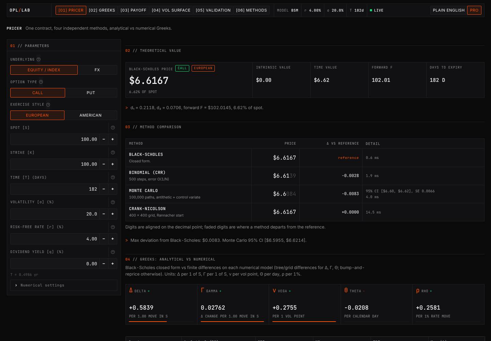
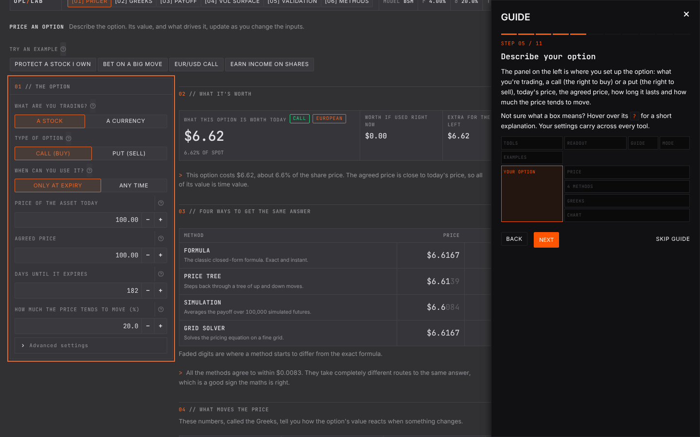
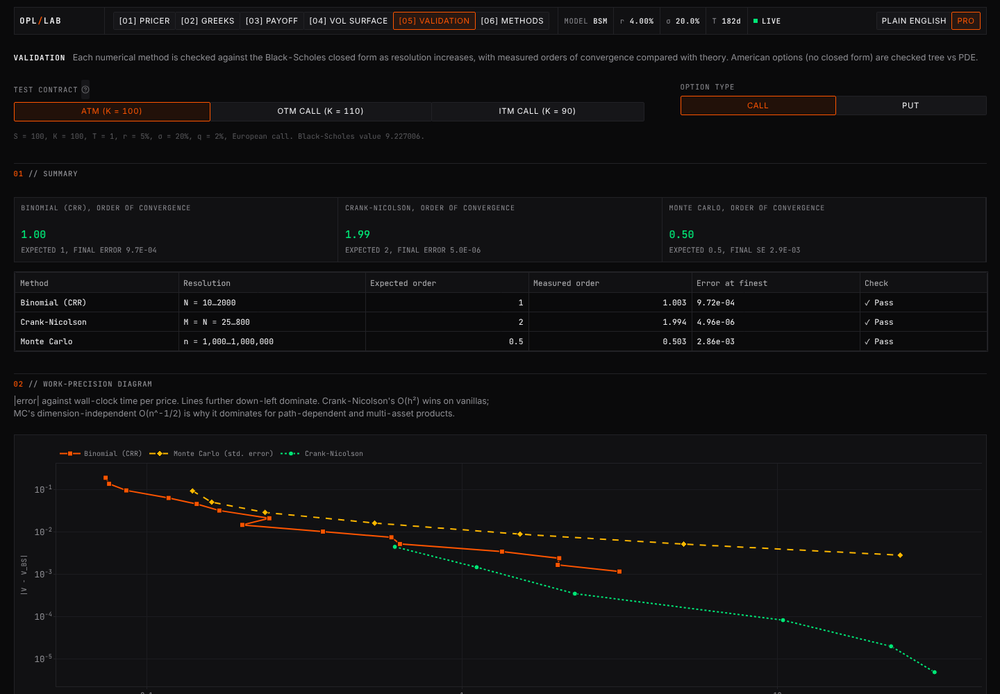
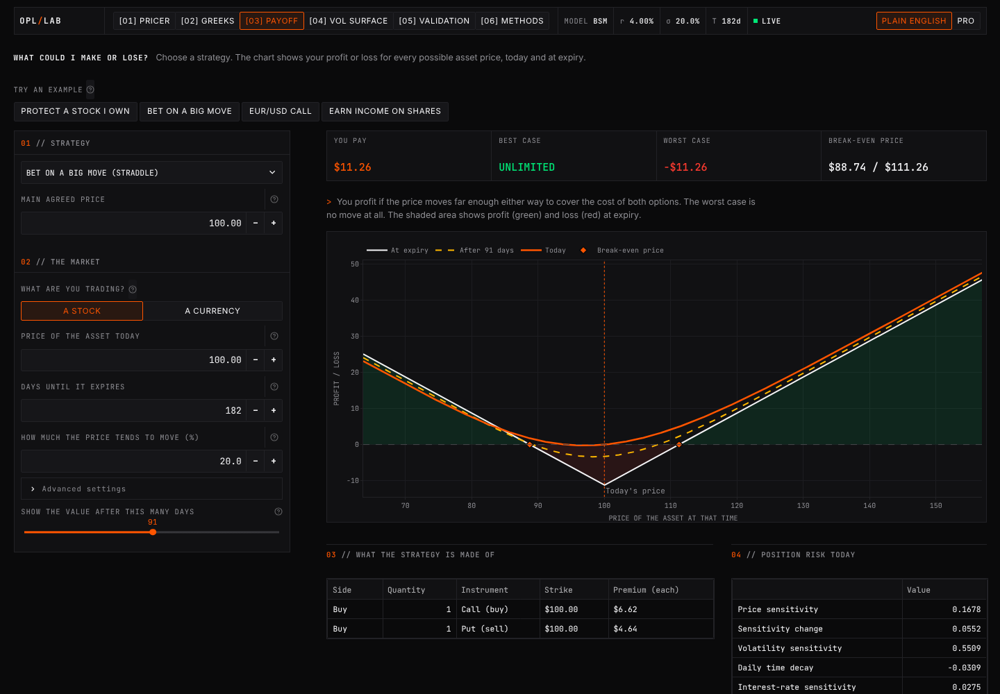
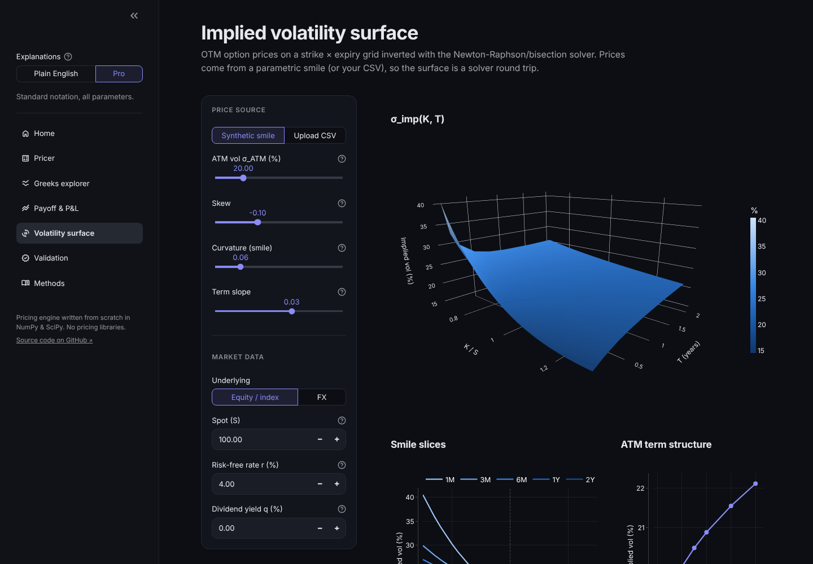
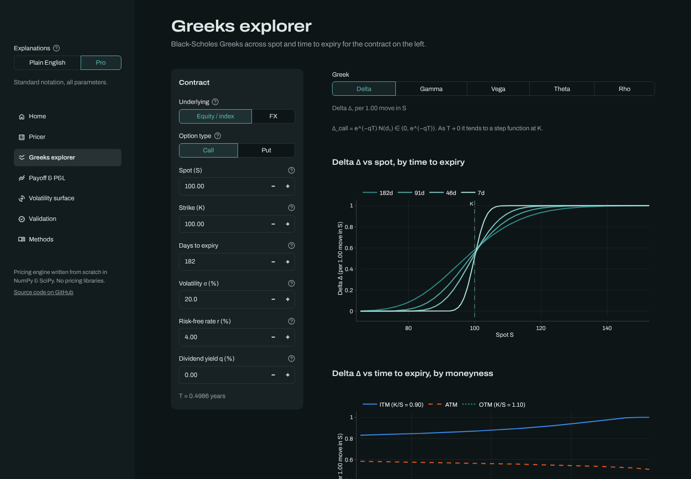
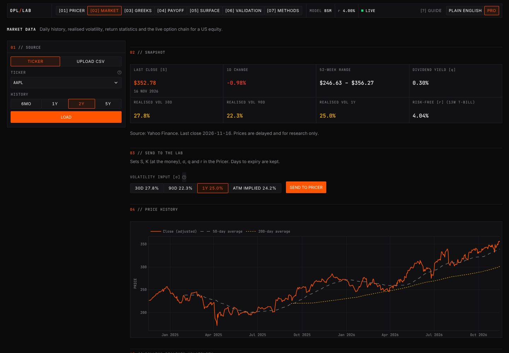
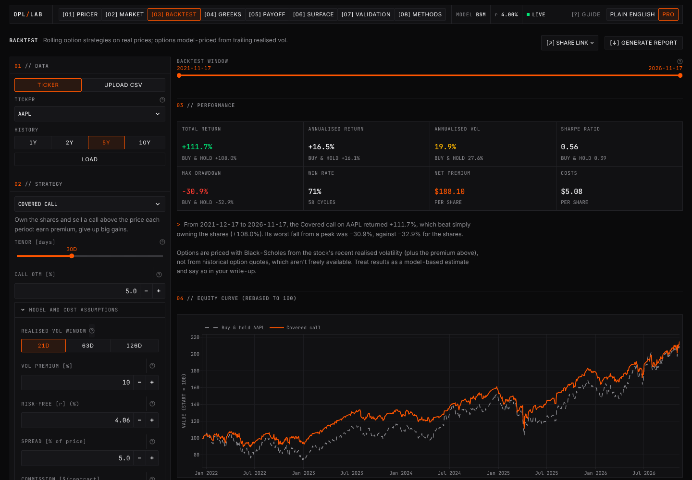
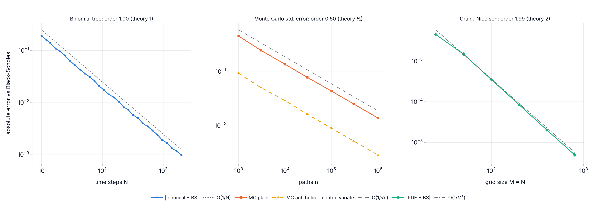

# Options Pricing Lab

[](https://options-pricing-lab-bastianfh.streamlit.app/)
[](https://github.com/bastianfh/options-pricing-lab/actions/workflows/tests.yml)


**An app that prices options four different ways and shows they all land on the same answer. I wrote the pricing maths myself instead of using an existing library.**

**Try it live: [options-pricing-lab-bastianfh.streamlit.app](https://options-pricing-lab-bastianfh.streamlit.app/)** (nothing to install)



## What it does

You set up an option (stock or currency, call or put, strike, expiry, volatility) and the app tells you:

- **What it's worth**, worked out four ways:
  - **Black-Scholes:** the classic formula. Exact and instant. For currencies it uses Garman-Kohlhagen, the FX version.
  - **Binomial tree:** splits time into small steps where the price can only go up or down, then works backwards from expiry.
  - **Monte Carlo:** simulates thousands of possible futures and averages what the option pays.
  - **Finite differences (Crank-Nicolson):** solves the Black-Scholes equation on a grid of prices and dates.
- **The Greeks:** how the price reacts when the stock moves, volatility changes, time passes, or rates change.
- **Implied volatility:** works backwards from a price to the volatility the market is assuming, and plots it as a 3D surface.
- **Profit and loss** for common strategies like straddles, spreads and covered calls.

The first time you switch to Plain English or Pro, a short **guide** walks you through where everything is, highlighting each part of the screen as it goes. You can reopen it anytime with **[?] GUIDE** in the top bar.



There's a **Simple / Plain English / Pro** switch in the top bar.

- **Simple** (the default) is for complete beginners. It cuts the app down to two screens with no jargon:
  - **Option price:** pick a stock, pick "price goes up" or "price goes down", a strike and when it ends. You see the cost, break-even, the most you can lose and make, the chance of profit, what happens if the stock moves ±10–20%, and a profit/loss chart.
  - **Backtest:** pick a stock, a strategy and a starting amount. You see what it became next to just owning the shares, the biggest drop, a low/medium/high risk level and how many months won. Volatility, rates and costs are filled in for you.
  - Every chart has a **Save image** button (a sharp PNG), and **Generate report** downloads a one-page report of your choices, results and charts.
- **Plain English** explains everything in everyday words.
- **Pro** shows the proper notation and extra detail.

The app opens in Simple. To open it straight in another mode, add [`?mode=Plain`](https://options-pricing-lab-bastianfh.streamlit.app/?mode=Plain) or [`?mode=Pro`](https://options-pricing-lab-bastianfh.streamlit.app/?mode=Pro) to the link. Share links made on the other modes keep their mode.

## The app's pages

The look is a dark trading terminal crossed with hardware-style panels: monospace numbers that line up, thin dividing lines, and one orange accent for whatever you're changing. Green means call / profit, red means put / loss, amber means volatility.


| Page | What's on it |
|---|---|
| **Pricer** | The starting page: price, all four methods side by side, the Greeks, and example scenarios |
| **Market** | Load any real US stock (or upload a CSV/Excel file): price history, volatility, return stats, the live option chain, and a button that sends its real numbers to the pricer |
| **Backtest** | Replay an option strategy (covered call, collar, iron condor… or one you build yourself) on a stock's real history and compare it with buy-and-hold |
| **Greeks explorer** | Charts of how each Greek changes with the stock price and time |
| **Payoff & P&L** | What a strategy makes or loses at expiry and before |
| **Volatility surface** | 3D implied volatility surface and smile charts |
| **Validation** | Proof the numbers are right (see below) |
| **Methods** | Short explanation of each model, with the equations |

<table>
<tr>
<td><br><sub><b>Validation</b></sub></td>
<td><br><sub><b>Payoff & P&L</b> (Plain English mode)</sub></td>
</tr>
<tr>
<td><br><sub><b>Volatility surface</b></sub></td>
<td><br><sub><b>Greeks explorer</b></sub></td>
</tr>
</table>

## Real stock data

The **Market** tool turns the lab into an investment analysis workspace for real US stocks:

- **Pick a ticker** (AAPL, MSFT, SPY, anything Yahoo Finance lists) or **upload a CSV or Excel file** of daily prices. Exports from FactSet, Yahoo Finance, Nasdaq.com and Stooq work as they are (title rows at the top of a FactSet sheet are skipped automatically). PDFs aren't supported, so export to Excel instead.
- **Snapshot:** last close, day change, 52-week range, trailing dividend yield, historical volatility over 30 days, 90 days and 1 year, and the current 13-week T-bill rate as the risk-free rate.
- **Analysis:** price with 50/200-day averages, rolling volatility, and the distribution of daily returns against a normal curve, with annual return, volatility, Sharpe ratio, max drawdown, skew and fat tails (excess kurtosis).
- **Option chain:** live quotes for any expiry, turned back into implied volatility by the lab's own solver and checked against Yahoo's figures. One click builds the stock's real volatility surface.
- **Send to the pricer:** fills the lab with the stock's real price, volatility, dividend yield and interest rate, so every other tool works on that stock.



Live data comes from Yahoo Finance through the `yfinance` package: it's free but unofficial, delayed, and meant for personal research. If it's unavailable, upload a CSV or Excel file instead. The tests use a fake data source, so they never depend on the internet.

## For class projects: backtests, reports and share links

**Backtest a strategy.** Pick a stock, a strategy (covered call, protective put, collar, cash-secured put, straddle, strangle, bull/bear spreads, iron condor) and how often to roll it. You can change how many of each leg you trade (say 2 calls and 1 put on a straddle, or sell 2 calls against 1 in a ratio spread). Or pick **Build your own** and put together up to 8 legs (buy or sell shares, calls and puts, with strikes as a % of the price). You can start from any ready-made strategy and tweak it, and a payoff chart shows what one period looks like so you can check you built what you meant. The app replays it over up to 10 years of real prices and shows the equity curve against buy-and-hold, drawdowns, profit or loss per cycle, a full trade log, and return, volatility, Sharpe ratio, max drawdown and win rate. Costs (bid-ask spread and commission) and a volatility premium are adjustable.

- **Exit rules (optional, off by default).** Close the options early at a profit target or a stop loss, both set as a % of the premium (e.g. take profit at 50%, stop at 200%). The trade log shows which periods closed early and why.
- **Compare up to 4 strategies.** Press *+ Add to comparison* for each strategy you want, then switch to *Compare*. They're all tested on the same stock, dates and costs, with one table, overlaid equity and drawdown charts, and a line saying which did best on return, risk-adjusted return and worst fall. The report and share link include the whole comparison.
- **For your paper.** A ready-made methods paragraph built from your exact settings, a checklist of what to include, and the citation, all with copy buttons.

One thing to state in a paper: free historical option prices don't exist, so the backtest prices each option with Black-Scholes using the stock's recent realised volatility. The app says this on the page and in every report.



**Optional: real market prices.** On the Payoff page, *Price from live option chain* (off by default) builds the strategy from today's real quotes for the stock loaded in Market: buying at the ask, selling at the bid, each option with its own implied volatility. Every strategy also shows its probability of profit and the market's expected move.

**Generate report.** On the Pricer, Market, Backtest, Payoff and Validation pages, *Generate report* downloads a self-contained report with your inputs, results, charts, trade log, method and limitations, data source and a ready-made citation. Open it in any browser and use *Print → Save as PDF* for a clean PDF. It works offline.

**Share link.** *Share link* gives a URL that reopens the tool with exactly your settings (ticker, dates, strategy, assumptions), so a teacher or classmate can check or reproduce a result.

## How I know the numbers are right

Black-Scholes gives an exact answer for simple options, so I can check the other three methods against it. Give each method more computing power (more steps, more simulations, a finer grid) and its error should shrink at a speed the theory predicts:



| Method | What the theory says | What I measured |
|---|---|---|
| Binomial tree | double the steps → error halves | Matches |
| Finite differences | double the grid → error drops 4× | Matches |
| Monte Carlo | 4× the simulations → error halves | Matches |

The Validation page in the app has the full charts and tables.

There are also **420 automated tests**. They check textbook examples from Hull and Haug, basic rules like put-call parity, that each method gets close to Black-Scholes, and that every page of the app loads and switches correctly in both modes. They run automatically on GitHub every time I push code.

## Using it with a class

- It works on phones: panels stack, the tool tabs swipe sideways, and swiping over a chart scrolls the page instead of zooming.
- **[!] Feedback** in the top bar opens a new GitHub issue by default. To send students to a Google Form instead, add this to the app's secrets (on Streamlit Cloud: *Manage app → Settings → Secrets*):

  ```toml
  feedback_url = "https://forms.gle/your-form"
  ```

## Run it on your own computer

You need **Python 3.12 or 3.13**.

```bash
git clone https://github.com/bastianfh/options-pricing-lab.git
```

```bash
cd options-pricing-lab
```

```bash
python -m venv .venv && source .venv/bin/activate
```

```bash
pip install -r requirements.txt
```

```bash
streamlit run streamlit_app.py
```

It opens in your browser at http://localhost:8501. (On Windows, activate the environment with `.venv\Scripts\Activate.ps1` instead.)

To run the tests:

```bash
pip install -r requirements-dev.txt
```

```bash
pytest
```

## How the code is organised

```
pricing/            the maths: all four pricing methods, Greeks, implied volatility, price statistics, backtests
marketdata/         gets real stock data in (Yahoo Finance, CSV or Excel) and tidies it
app/                the website: pages, styling, and all the text (content.py)
tests/              automated tests
docs/               detailed write-up of the maths (methods.md) and screenshots
streamlit_app.py    starts the app
```

The pricing code doesn't depend on the website at all, so you can use it on its own:

```python
from pricing import OptionSpec, price_all

option = OptionSpec(S=100, K=95, T=0.5, r=0.04, sigma=0.25, option_type="put")
for method, result in price_all(option).items():
    print(method.value, round(result.price, 4))
```

Want the full maths, the equations, and why I made certain choices? See **[docs/methods.md](docs/methods.md)**.

## What I learned

This project connects two things I care about: the options theory I learn in class and the FX markets I trade.

### What building it taught me

Building the formula four different ways has taught me a lot about the fact that these mathematical equations are far more than just a derivation. It also helped me visualize concepts that I have struggled with in the past. Although I have a significant amount of experience trading options, visualizing a trade in a bite-sized way is often extremely helpful rather than trying to number-crunch on the go.

### What I want to learn next

Next, I want to learn more about how to calibrate models to market prices, and how to actually make use of this in personal trading. I also want to look more at the potential of hedging.

## Ideas for later

- Better handling of American options (options you can exercise early)
- Exotic options like Asian and barrier options
- Volatility models where volatility isn't constant (e.g. Heston), fitted to real market prices
- FX-style quoting (25-delta risk reversals and butterflies)
- Live market data instead of typing prices in

## License

[MIT](LICENSE). Built for learning, not trading advice.
