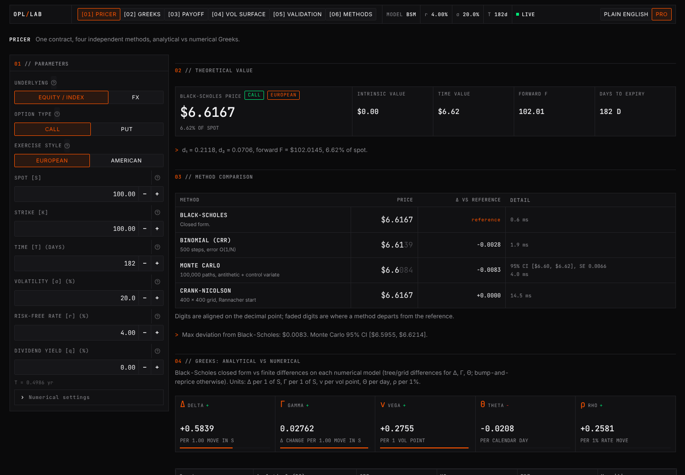
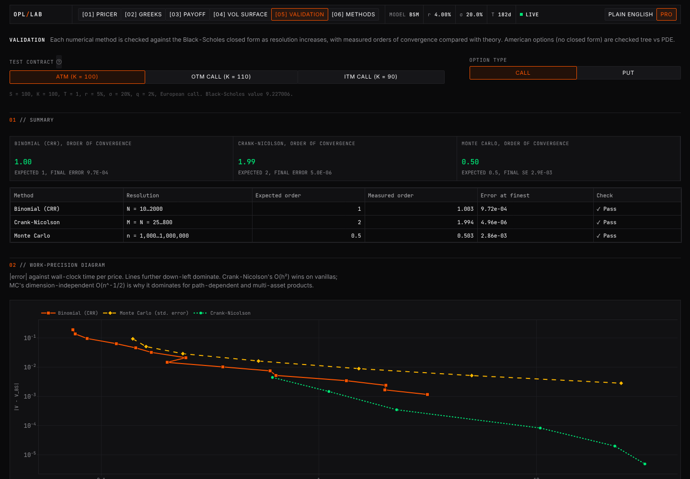
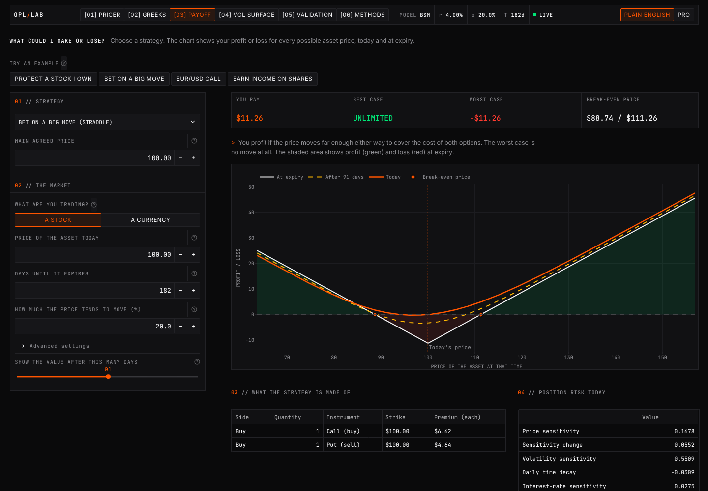

# Options Pricing Lab

[](https://options-pricing-lab-bastianfh.streamlit.app/)
[](https://github.com/bastianfh/options-pricing-lab/actions/workflows/tests.yml)


**An app that prices options four different ways and shows they all land on the same answer. I wrote the pricing maths myself instead of using an existing library.**

**Try it live: [options-pricing-lab-bastianfh.streamlit.app](https://options-pricing-lab-bastianfh.streamlit.app/)** (nothing to install)



## What it does

You set up an option (stock or currency, call or put, strike, expiry, volatility) and the app tells you:

- **What it's worth**, worked out four ways:
  - **Black-Scholes:** the classic formula. Exact and instant. For currencies it uses Garman-Kohlhagen, the FX version.
  - **Binomial tree:** splits time into small steps where the price can only go up or down, then works backwards from expiry.
  - **Monte Carlo:** simulates thousands of possible futures and averages what the option pays.
  - **Finite differences (Crank-Nicolson):** solves the Black-Scholes equation on a grid of prices and dates.
- **The Greeks:** how the price reacts when the stock moves, volatility changes, time passes, or rates change.
- **Implied volatility:** works backwards from a price to the volatility the market is assuming, and plots it as a 3D surface.
- **Profit and loss** for common strategies like straddles, spreads and covered calls.

There's a **Plain English / Pro** switch in the top bar. Plain English explains everything in everyday words; Pro shows the proper notation and extra detail. To open the app straight in Pro mode, add [`?mode=Pro`](https://options-pricing-lab-bastianfh.streamlit.app/?mode=Pro) to the link.

## The app's pages

The look is a dark trading terminal crossed with hardware-style panels: monospace numbers that line up, thin dividing lines, and one orange accent for whatever you're changing. Green means call / profit, red means put / loss, amber means volatility.


| Page | What's on it |
|---|---|
| **Pricer** | The starting page: price, all four methods side by side, the Greeks, and example scenarios |
| **Greeks explorer** | Charts of how each Greek changes with the stock price and time |
| **Payoff & P&L** | What a strategy makes or loses at expiry and before |
| **Volatility surface** | 3D implied volatility surface and smile charts |
| **Validation** | Proof the numbers are right (see below) |
| **Methods** | Short explanation of each model, with the equations |

<table>
<tr>
<td><br><sub><b>Validation</b></sub></td>
<td><br><sub><b>Payoff & P&L</b> (Plain English mode)</sub></td>
</tr>
<tr>
<td><br><sub><b>Volatility surface</b></sub></td>
<td><br><sub><b>Greeks explorer</b></sub></td>
</tr>
</table>

## How I know the numbers are right

Black-Scholes gives an exact answer for simple options, so I can check the other three methods against it. Give each method more computing power (more steps, more simulations, a finer grid) and its error should shrink at a speed the theory predicts:


| Method | What the theory says | What I measured |
|---|---|---|
| Binomial tree | double the steps → error halves | Matches |
| Finite differences | double the grid → error drops 4× | Matches |
| Monte Carlo | 4× the simulations → error halves | Matches |

The Validation page in the app has the full charts and tables.

There are also **328 automated tests**. They check textbook examples from Hull and Haug, basic rules like put-call parity, that each method gets close to Black-Scholes, and that every page of the app loads and switches correctly in both modes. They run automatically on GitHub every time I push code.

## Run it on your own computer

You need **Python 3.12 or 3.13**.

```bash
git clone https://github.com/bastianfh/options-pricing-lab.git
```

```bash
cd options-pricing-lab
```

```bash
python -m venv .venv && source .venv/bin/activate
```

```bash
pip install -r requirements.txt
```

```bash
streamlit run streamlit_app.py
```

It opens in your browser at http://localhost:8501. (On Windows, activate the environment with `.venv\Scripts\Activate.ps1` instead.)

To run the tests:

```bash
pip install -r requirements-dev.txt
```

```bash
pytest
```

## How the code is organised

```
pricing/            the maths: all four pricing methods, Greeks, implied volatility
app/                the website: pages, styling, and all the text (content.py)
tests/              automated tests
docs/               detailed write-up of the maths (methods.md) and screenshots
streamlit_app.py    starts the app
```

The pricing code doesn't depend on the website at all, so you can use it on its own:

```python
from pricing import OptionSpec, price_all

option = OptionSpec(S=100, K=95, T=0.5, r=0.04, sigma=0.25, option_type="put")
for method, result in price_all(option).items():
    print(method.value, round(result.price, 4))
```

Want the full maths, the equations, and why I made certain choices? See **[docs/methods.md](docs/methods.md)**.

## What I learned

This project connects two things I care about: the options theory I learn in class and the FX markets I trade.

### What building it taught me

Building the formula four different ways has taught me a lot about the fact that these mathematical equations are far more than just a derivation. It also helped me visualize concepts that I have struggled with in the past. Although I have a significant amount of experience trading options, visualizing a trade in a bite-sized way is often extremely helpful rather than trying to number-crunch on the go.

### What I want to learn next

Next, I want to learn more about how to calibrate models to market prices, and how to actually make use of this in personal trading. I also want to look more at the potential of hedging.

## Ideas for later

- Better handling of American options (options you can exercise early)
- Exotic options like Asian and barrier options
- Volatility models where volatility isn't constant (e.g. Heston), fitted to real market prices
- FX-style quoting (25-delta risk reversals and butterflies)
- Live market data instead of typing prices in

## License

[MIT](LICENSE). Built for learning, not trading advice.
