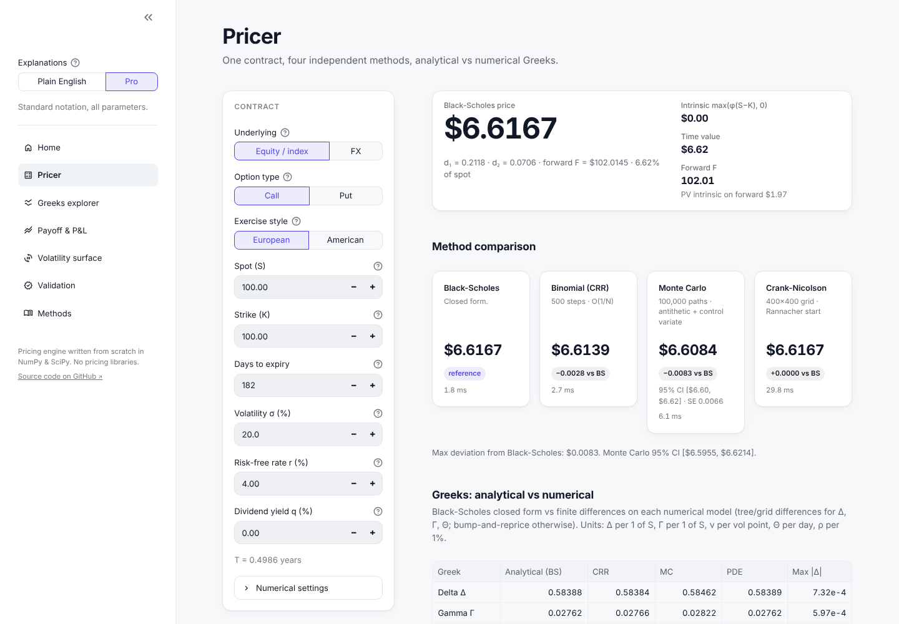
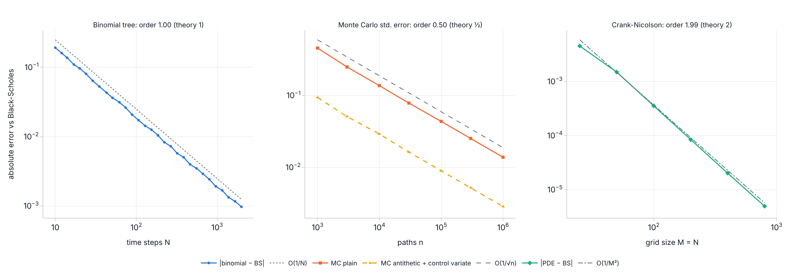
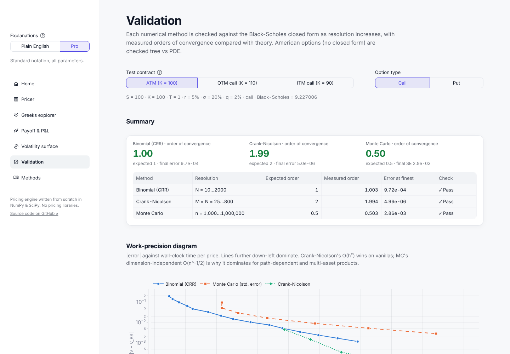
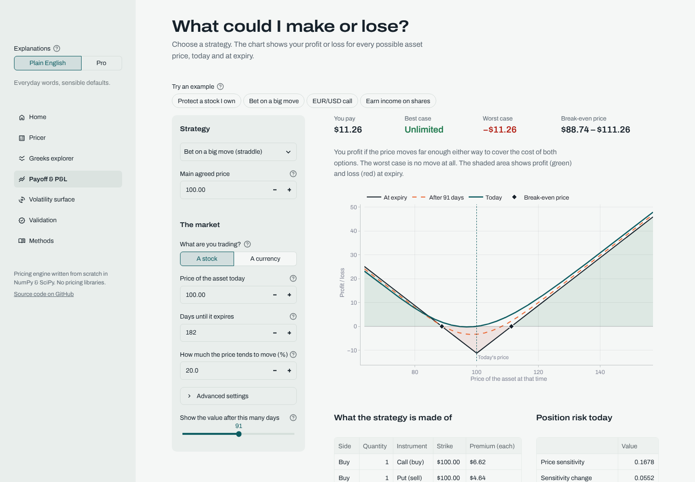
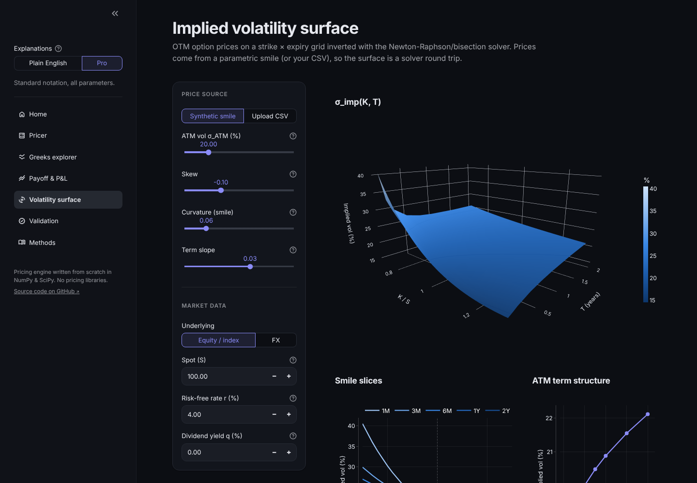
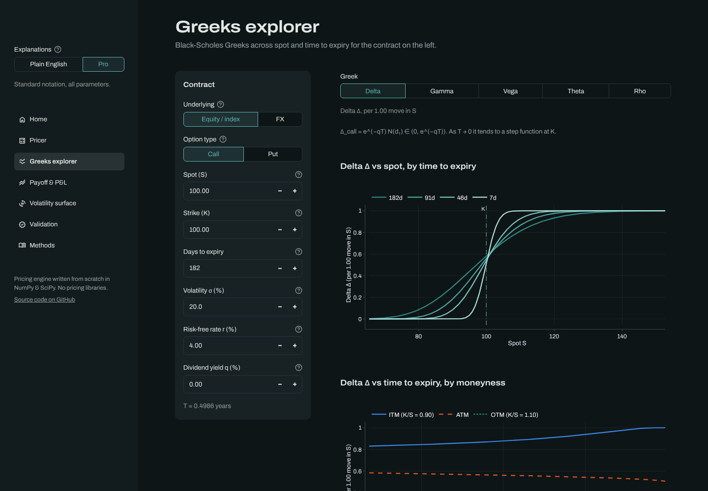

# Options Pricing Lab

[](https://options-pricing-lab-bastianfh.streamlit.app/)
[](https://github.com/bastianfh/options-pricing-lab/actions/workflows/tests.yml)


**An options pricing and risk library written from scratch in NumPy/SciPy, with an interactive lab that prices every option four independent ways and proves they agree.**

**Live demo: [options-pricing-lab-bastianfh.streamlit.app](https://options-pricing-lab-bastianfh.streamlit.app/)**. No install needed. Add [`?mode=Pro`](https://options-pricing-lab-bastianfh.streamlit.app/?mode=Pro) to the URL to open it in Pro mode.



## Headline result: every numerical method converges to Black-Scholes at the rate theory predicts



| Method | Resolution | Theoretical order | Measured order | Error at finest resolution |
|---|---|---|---|---|
| Cox-Ross-Rubinstein binomial tree | N = 10 … 2,000 steps | 1 | **1.00** | 9.7 × 10⁻⁴ |
| Crank-Nicolson finite differences | M = N = 25 … 800 | 2 | **1.99** | 5.0 × 10⁻⁶ |
| Monte Carlo (standard error) | n = 10³ … 10⁶ paths | ½ | **0.50** | 2.9 × 10⁻³ (antithetic + control variate, ≈ 20× variance reduction) |

*ATM European call, S = K = 100, T = 1, r = 5%, q = 2%, σ = 20%. Black-Scholes = 9.227006. Reproduce with `python scripts/make_figures.py` or on the app's Validation page.*

## Features

**Pricing engine** (`pricing/`, no UI code, no third-party pricing libraries)
- **Black-Scholes-Merton** for European calls/puts with a dividend yield, and **Garman-Kohlhagen** for FX options (domestic and foreign rates)
- **Cox-Ross-Rubinstein binomial tree** with European and **American** exercise
- **Monte Carlo** with **antithetic variates** and a **control variate**, reporting standard errors and 95% confidence intervals
- **Crank-Nicolson** PDE solver with Rannacher smoothing, payoff cell-averaging and American exercise
- **Greeks** (Δ, Γ, ν, Θ, ρ): closed-form for Black-Scholes and finite differences for every numerical model, compared side by side
- **Implied volatility** by Newton-Raphson with a bisection fallback, and a **3D implied volatility surface**
- Multi-leg **strategy** payoffs and P&L, and **convergence studies** with empirical orders of convergence

**Interactive app** (`app/`, Streamlit)
- **Plain English / Pro switch** at the top of the sidebar. Plain English translates every term ("Spot (S)" becomes "Price of the asset today"), explains every result in one line and hides advanced settings. Pro shows notation, every parameter, diagnostics and equations. All wording lives in one file, [`app/content.py`](app/content.py).
- **Pricer:** inputs on the left; the price, all four methods side by side and the Greeks table on the right
- **Greeks explorer:** each Greek against spot and against time to expiry, plus a heatmap
- **Payoff & P&L:** straddle, strangle, bull/bear spreads, covered call, protective put or custom legs; P&L at expiry, today and at any horizon
- **Volatility surface:** interactive 3D surface, smile slices, term structure; upload your own quotes as CSV
- **Validation:** convergence plots, error tables, a work-precision diagram, American tree vs PDE, Greeks and put-call parity checks
- **Methods:** a concise write-up of each model with LaTeX equations
- FX-aware: currency pairs, premiums in pips and per 1m notional
- Designed light and dark themes, one shared Plotly chart theme, and a CVD-checked palette

<table>
<tr>
<td><br><sub><b>Validation:</b> measured vs theoretical convergence</sub></td>
<td><br><sub><b>Payoff & P&L</b> in Plain English mode</sub></td>
</tr>
<tr>
<td><br><sub><b>Implied volatility surface</b> (dark mode)</sub></td>
<td><br><sub><b>Greeks explorer</b> (dark mode)</sub></td>
</tr>
</table>

## Methods in brief

Full derivations, implementation choices and references are in **[docs/methods.md](docs/methods.md)**.

**Black-Scholes-Merton / Garman-Kohlhagen.** With $\phi = \pm1$ for calls and puts and $q = r_f$ for FX:

$$
V = \phi\left[S e^{-qT} N(\phi d_1) - K e^{-rT} N(\phi d_2)\right],\qquad
d_{1,2} = \frac{\ln(S/K) + (r - q \pm \tfrac12\sigma^2)T}{\sigma\sqrt T}
$$

**Binomial tree (CRR).** $u = e^{\sigma\sqrt{\Delta t}}$, $d = 1/u$, $p = \dfrac{e^{(r-q)\Delta t} - d}{u-d}$, and backward induction
$V_{i,j} = e^{-r\Delta t}[pV_{i+1,j+1} + (1-p)V_{i+1,j}]$, taking $\max(V_{i,j}, \text{payoff})$ for American exercise.

**Monte Carlo.** Exact sampling $S_T = S_0 e^{(r-q-\sigma^2/2)T + \sigma\sqrt T Z}$; estimator $\hat V = e^{-rT}\overline{f(S_T)}$ with $\text{SE} = s/\sqrt n$. Control variate $X = e^{-rT}S_T$ with known mean $S_0e^{-qT}$:
$\hat V_{cv} = \bar Y - \hat\beta(\bar X - S_0e^{-qT})$.

**Crank-Nicolson.** In $x = \ln S$, $\tau = T - t$: $\;(I - \tfrac12\Delta\tau L)V^{n+1} = (I + \tfrac12\Delta\tau L)V^n$, where $L$ discretises $\tfrac12\sigma^2\partial_{xx} + (r-q-\tfrac12\sigma^2)\partial_x - r$; one tridiagonal solve per step, second order in space and time.

**Implied volatility.** $\sigma_{k+1} = \sigma_k - \dfrac{BS(\sigma_k) - V_{\text{mkt}}}{\nu(\sigma_k)}$ inside a shrinking bracket, falling back to bisection whenever Newton would leave it.

## Run it locally

Requires Python 3.12 or 3.13.

```bash
git clone https://github.com/bastianfh/options-pricing-lab.git
```

```bash
cd options-pricing-lab
```

```bash
python -m venv .venv && source .venv/bin/activate
```

```bash
pip install -r requirements.txt
```

```bash
streamlit run streamlit_app.py
```

The app opens at http://localhost:8501. Add `?mode=Pro` to the URL to open in Pro mode.

## Tests

```bash
pip install -r requirements-dev.txt
```

```bash
pytest
```

315 checks (313 unit tests plus 2 doctests) run in about 4 seconds and on every push via [GitHub Actions](.github/workflows/tests.yml). They cover:

- **Textbook values:** Hull Examples 15.6, 19.1 and 21.1; Haug's dividend-yield and Garman-Kohlhagen examples
- **No-arbitrage:** put-call parity, price bounds, American put ≥ European put, American call without dividends equals European
- **Convergence:** each numerical method within tolerance of Black-Scholes, with measured orders of 1 (tree), 2 (PDE) and ½ (Monte Carlo SE)
- **Monte Carlo statistics:** 95% CI coverage over 400 independent runs, 1/√n scaling, every variance-reduction technique lowers the SE
- **Implied vol:** price → IV → price round trips across 160 strike/expiry/vol/type combinations, the bisection fallback, surface recovery
- **Greeks:** numerical vs analytical for every model, parity relations and the Black-Scholes PDE identity $\Theta + (r-q)S\Delta + \tfrac12\sigma^2S^2\Gamma = rV$

## Use the library directly

```python
from pricing import OptionSpec, Method, price_all, greeks, implied_volatility, garman_kohlhagen_price

spec = OptionSpec(S=100, K=95, T=0.5, r=0.04, sigma=0.25, q=0.01, option_type="put", exercise="american")
for method, result in price_all(spec).items():
    print(method.value, result.price, result.reason)        # BS/MC report "european_only" for American puts

print(greeks(spec, Method.FINITE_DIFFERENCE))               # grid delta/gamma, bumped vega/theta/rho
print(garman_kohlhagen_price(1.085, 1.10, 0.25, 0.043, 0.025, 0.075, "call"))   # EUR/USD call
print(implied_volatility(4.12, S=100, K=100, T=0.5, r=0.04))
```

## Project structure

```
pricing/                     pricing library (NumPy/SciPy only)
├── models/
│   ├── black_scholes.py     Black-Scholes-Merton, Garman-Kohlhagen
│   ├── binomial.py          CRR tree, European + American, tree Greeks
│   ├── monte_carlo.py       GBM Monte Carlo, antithetic + control variates
│   └── finite_difference.py Crank-Nicolson with Rannacher start
├── greeks.py                analytical and bump-and-reprice Greeks
├── implied_vol.py           Newton/bisection IV solver, surfaces
├── strategies.py            multi-leg payoff, P&L, risk metrics
├── convergence.py           convergence studies, empirical order
├── engine.py                one API across all methods
└── utils.py                 shared types, validation, payoffs
app/
├── content.py               all user-facing wording (Plain English + Pro)
├── theme.py                 palette and shared Plotly chart theme
├── ui.py                    sidebar, mode toggle, inputs, cards
├── style.css                custom CSS on top of the Streamlit theme
└── pages/                   home, pricer, greeks, payoff, surface, validation, methods
tests/                       pytest suite
docs/                        methods write-up, development plan, images
scripts/                     README figure and screenshot tooling
streamlit_app.py             entry point
.streamlit/config.toml       light and dark themes
```

Design and scope decisions are recorded in [docs/development-plan.md](docs/development-plan.md).

## Deploy to Streamlit Community Cloud

The app is live at **https://options-pricing-lab-bastianfh.streamlit.app/**. To deploy your own copy (e.g. from a fork): `streamlit_app.py` is the default entry point, `requirements.txt` is pinned, and `.streamlit/config.toml` carries the theme.

1. Push the repo to GitHub and make it public (or grant Streamlit access to it).
2. Sign in at [share.streamlit.io](https://share.streamlit.io) with your GitHub account.
3. Click **Create app**, then **Deploy a public app from GitHub**.
4. Choose repository `bastianfh/options-pricing-lab`, your deployment branch, and main file path `streamlit_app.py`.
5. Open **Advanced settings** and set **Python version** to **3.12** or **3.13** (NumPy 2.5 needs ≥ 3.12).
6. Optionally pick a custom subdomain, then click **Deploy**.

No secrets or environment variables are needed.

## What I learned / next steps

> *To fill in. Some prompts:*
>
> - *Why the binomial error oscillates and how reading Greeks off the tree fixes aliasing*
> - *Why plain Crank-Nicolson was not enough (Rannacher smoothing, payoff cell-averaging)*
> - *How antithetic pairs change the standard error calculation, and why the control variate makes MC put-call parity exact*
> - *How this connects to my FX trading (Garman-Kohlhagen, pips, notional)*

**Next steps**
- PSOR or a penalty method for American options, to restore second order near the exercise boundary
- Leisen-Reimer trees, for smooth O(1/N²) convergence without oscillation
- Barrier and Asian options (Monte Carlo with Brownian-bridge correction)
- Local volatility (Dupire) or Heston calibrated to the implied vol surface
- An arbitrage-free SVI fit for the surface, and FX delta-based strike conventions (25Δ risk reversals and butterflies)
- Live FX and equity quotes for the volatility surface

## License

[MIT](LICENSE). For education and research; model prices are not trading advice.
